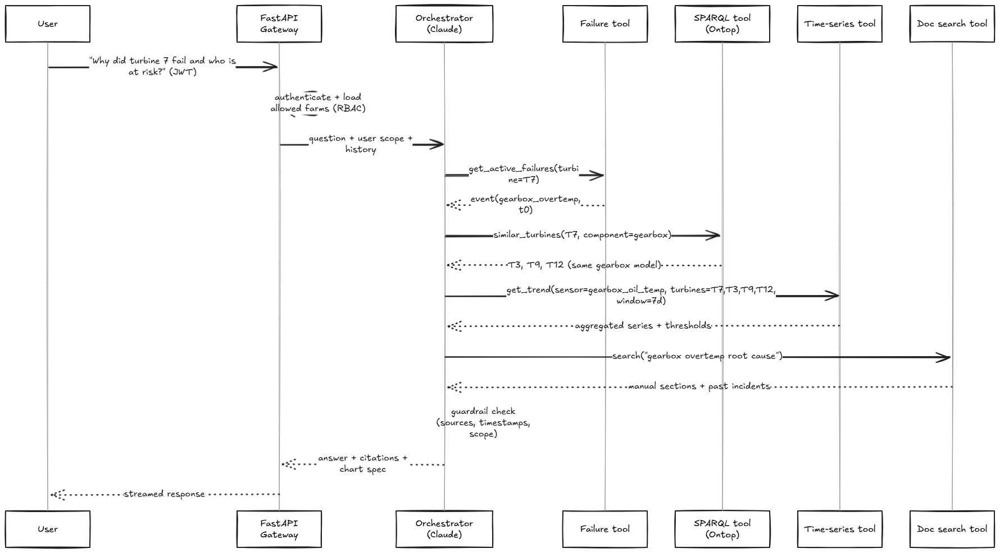
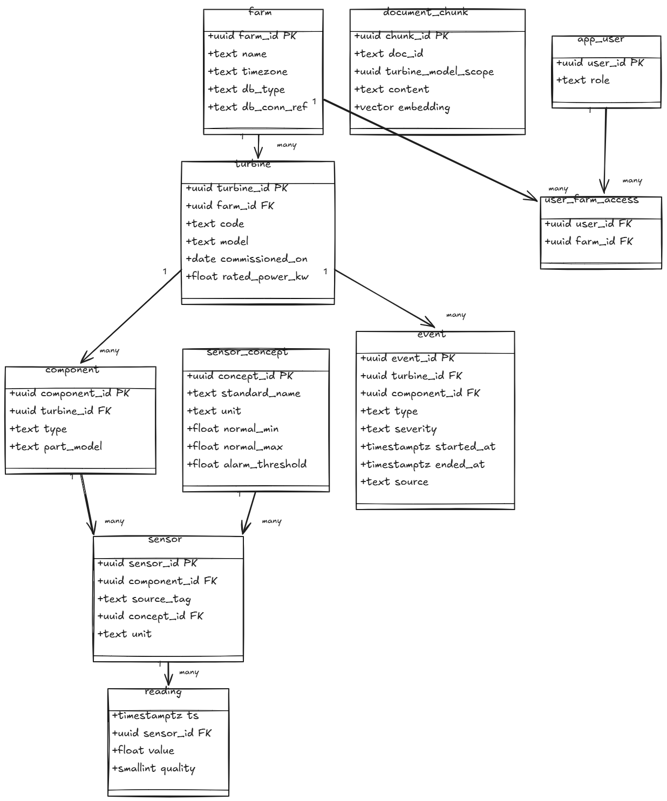
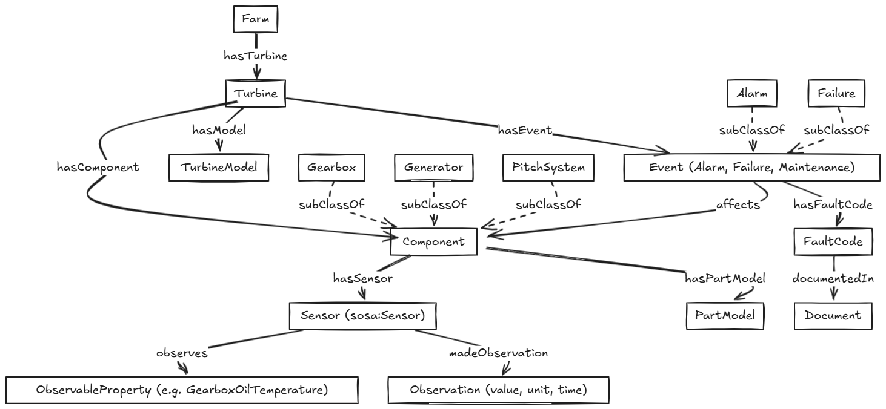

# Wind Farm AI Assistant: System Design (HLD + LLD)

A chatbot that lets users ask free-form questions about wind farms, turbines, sensors, live and historical data, and failures. The system covers multiple farms, each with its own database(s), plus a live data API.

**Status:** design proposal for validation. Nothing here is built yet. Items marked **[verify]** are assumptions or recalled-from-memory details that should be checked before committing.

Diagram sources (`.excalidraw`) and images (`.png`) are in [`diagrams/`](diagrams/).

---

## 1. Problem and requirements

**Inputs**
- Multiple farms; each farm has multiple turbines; each turbine has its own sensors.
- Each farm has its own database (types and schemas may differ).
- Live data arrives through an API and is stored in the farm databases.

**What users ask (examples)**
| Type | Example |
|---|---|
| Current state | "What is the power output of turbine 5 right now?" |
| History / aggregates | "Average gearbox temperature for Farm B last week" |
| Failure / alarm | "Which turbines have a failure?" |
| Relationship / root cause | "Why did turbine 7 fail, and which similar turbines are at risk?" |
| Knowledge | "What does fault code 4021 mean?" |
| Comparison | "Which turbine underperformed this month?" |

**Non-functional requirements**
- Correct, sourced answers (every answer shows its data source and timestamp)
- Per-user access control (users only see farms they are allowed to see)
- Read-only access to operational data from the chat path
- Low latency for common questions; streamed responses
- Works across heterogeneous farm DBs without copying everything blindly

---

## 2. Key design decisions

| # | Decision | Rationale | Alternative considered |
|---|---|---|---|
| D1 | **Ontology (OWL) + Ontop virtual knowledge graph** as the semantic layer | One DB per farm with different schemas. Ontop maps each DB to one shared ontology and rewrites SPARQL to SQL, so no data is copied. | Neo4j (requires loading data, a second graph to maintain) |
| D2 | **TimescaleDB** for time-series history and aggregates | SQL, continuous aggregates, retention policies, plain Postgres tooling. | ClickHouse (larger scale), InfluxDB |
| D3 | **Tool calling, not free-form query generation**, for the main path | More reliable and secure. The LLM selects tools and arguments; code builds the queries. | Free-form text-to-SQL / text-to-SPARQL |
| D4 | **LLM never detects failures or does math** | Detection is a separate pipeline (rules + ML). Aggregation happens in the DB. The LLM only explains tool results. | LLM reading raw rows |
| D5 | **pgvector** for RAG over manuals, fault codes, and maintenance logs | Keeps vectors in Postgres, one fewer system. | Qdrant |
| D6 | **Hybrid data access**: virtual KG for structure, Timescale for time-series, live API for "now" | Each is used where it is strongest. | One store for everything |
| D7 | **Neo4j not included** | Ontop plus the ontology covers relationship questions. Can be added later if graph algorithms are needed. | Neo4j alongside Ontop |

Supporting evidence from research (preprints, vendor blogs, and prototypes; evidence is thin and mostly not head-to-head on industrial time series):
- Time-series windowing and downsampling are a known weak point of plain text-to-SQL; semantic/graph layers over the schema are suggested to help.
- Question answering over wind turbine knowledge graphs exists as research prototypes (Chatterjee & Dethlefs, 2022; Verstraeten et al.).
- Semantic layers with predefined metrics report higher accuracy than raw text-to-SQL (vendor-reported).

Decide D1 and D3 with data: build the evaluation set (section 9) and measure.

---

## 3. High-Level Design (HLD)


### Layers
1. **Client:** Chat UI (Next.js) with streaming, charts, and citations.
2. **Gateway:** FastAPI; JWT authentication, RBAC (user to allowed farms), rate limiting.
3. **Orchestrator:** Claude tool-use agent loop. Plans, calls tools, composes the answer. Works with:
   - **Guardrails:** read-only enforcement, row limits, source and timestamp checks.
   - **Session store (Redis):** conversation history and short-lived cache.
4. **Tools** (each with a JSON schema):
   - **SPARQL tool:** structural and relationship questions via Ontop.
   - **Time-series tool:** parameterised SQL over TimescaleDB.
   - **Doc search tool:** RAG over manuals and logs.
   - **Failure tool:** reads alarms and anomaly events.
   - **Live API tool:** real-time values not yet stored.
5. **Data layer:**
   - **Ontop + OWL ontology + mappings:** virtual KG over farm DBs (no copy).
   - **TimescaleDB:** history, aggregates, metadata, thresholds, events.
   - **pgvector:** document embeddings.
   - **Anomaly engine:** scheduled rules and ML scoring; writes events.
   - **Farm DBs:** per-farm sources of truth.
6. **Ingestion:** workers pull the live API and write into farm DBs; a sync job copies readings into TimescaleDB (ETL/CDC).
7. **Cross-cutting:** Keycloak/Auth0, OpenTelemetry + Grafana, Langfuse for LLM tracing, audit log, evaluation harness.

### Data paths
| Path | Source | Used for |
|---|---|---|
| Structure/relationships | Farm DBs via Ontop (virtual) | "What is part of what", "similar turbines" |
| Time-series | Farm DB to TimescaleDB (sync) | trends, aggregates, comparisons |
| Real-time | Live turbine API | "right now" values |
| Knowledge | Documents to pgvector | explanations, fault codes |
| Failures | Anomaly engine to events table | "which turbine has a failure" |

---

## 4. Low-Level Design (LLD)

### 4.1 Question flow (sequence)



Steps for "Why did turbine 7 fail and who is at risk?":
1. Gateway authenticates the user and loads allowed farms (RBAC).
2. Orchestrator calls **Failure tool** to get the active event for T7.
3. **SPARQL tool** finds turbines sharing the same gearbox model.
4. **Time-series tool** pulls the aggregated sensor trend for T7 and the similar turbines.
5. **Doc search tool** finds manual sections and past incidents.
6. Guardrails verify scope, citations, and timestamps; the answer streams to the user.

### 4.2 Backend module structure


Suggested repo layout:
```
backend/
  api/        routes/chat.py, routes/admin.py, middleware
  agent/      loop.py, prompts.py, guardrails.py, memory.py
  tools/      registry.py, sparql_tool.py, timeseries_tool.py,
              rag_tool.py, failure_tool.py, live_tool.py
  data/       ontop_client.py, timescale_repo.py, vector_repo.py, farm_router.py
  jobs/       ingest.py, sync.py, anomaly.py, embed_docs.py
ontology/     wind.owl, mappings/<farm>.obda
eval/         questions.yaml, run_eval.py
```

### 4.3 Metadata and time-series schema (PostgreSQL / TimescaleDB)



Notes:
- `sensor_concept` is the **standard name** layer: farm A `GBX_OIL_T` and farm B `gearbox_temp_1` both map to one concept (for example `gearbox_oil_temperature`) with unit, normal range, and alarm threshold.
- `reading` becomes a TimescaleDB **hypertable** on `ts`, with continuous aggregates (1 min, 10 min, 1 h) and a retention policy.
- `event` is written by the anomaly engine and by imported alarm codes; the Failure tool reads it.
- `farm.db_conn_ref` is a **reference** to a secret (for example a vault key), never a raw credential.

```sql
CREATE TABLE reading (
  ts        timestamptz NOT NULL,
  sensor_id uuid        NOT NULL REFERENCES sensor(sensor_id),
  value     double precision,
  quality   smallint
);
SELECT create_hypertable('reading', 'ts');
CREATE INDEX ON reading (sensor_id, ts DESC);
```

### 4.4 Ontology model



- Reuse **SOSA/SSN** for sensors and observations. Consider **IEC 61400-25** and **RDS-PP/KKS** for component naming, and **QUDT** for units **[verify scope and fit of each]**.
- Component subclasses (`Gearbox`, `Generator`, `PitchSystem`) enable queries like "all gearboxes of model X" through class hierarchy.
- Ontop mapping per farm (sketch; **[verify exact syntax against the Ontop version used]**):
```
[PrefixDeclaration]
:      http://example.org/wind#
sosa:  http://www.w3.org/ns/sosa/

[MappingDeclaration] @collection [[
mappingId  farmA-turbine
target     :turbine/{turbine_id} a :Turbine ; :hasCode {code} ; :partOfFarm :farm/{farm_id} .
source     SELECT turbine_id, code, farm_id FROM turbines
]]
```
- Ontop supports relational databases. If a farm stores data in a non-relational time-series store, expose it through a relational view or sync it into Timescale **[verify per farm]**.
- Ontop is for **structure and relationships**. Raw time-series reads go through the Time-series tool, not SPARQL.

### 4.5 Tool contracts

Each tool has a JSON schema; arguments are validated with Pydantic before any query runs. The LLM never submits raw SQL or SPARQL.

| Tool | Arguments | Returns |
|---|---|---|
| `get_latest_reading` | `turbine_id`, `concept` | value, unit, ts, source |
| `get_timeseries` | `turbine_ids[]`, `concept`, `start`, `end`, `agg` (1m/10m/1h/1d), `stat` (avg/min/max) | aggregated series (capped), thresholds |
| `list_failures` | `farm_id?`, `severity?`, `since?`, `active_only` | events with turbine, component, type, times |
| `find_similar_turbines` | `turbine_id`, `by` (model/component/part) | turbine list (via SPARQL template) |
| `get_turbine_structure` | `turbine_id` | components and sensors |
| `compare_turbines` | `turbine_ids[]`, `concept`, `period` | per-turbine stat and ranking |
| `search_docs` | `query`, `turbine_model?` | chunks with doc id and page |
| `get_live_value` | `turbine_id`, `concept` | live value, ts |

Example schema:
```json
{
  "name": "get_timeseries",
  "description": "Aggregated sensor values for one or more turbines over a time range.",
  "input_schema": {
    "type": "object",
    "properties": {
      "turbine_ids": {"type": "array", "items": {"type": "string"}, "maxItems": 20},
      "concept": {"type": "string", "description": "Standard sensor concept, e.g. gearbox_oil_temperature"},
      "start": {"type": "string", "format": "date-time"},
      "end": {"type": "string", "format": "date-time"},
      "agg": {"type": "string", "enum": ["1m", "10m", "1h", "1d"]},
      "stat": {"type": "string", "enum": ["avg", "min", "max"]}
    },
    "required": ["turbine_ids", "concept", "start", "end", "agg"]
  }
}
```

SPARQL is used through **predefined templates** with bound parameters (for example `similar_turbines`, `components_of`, `sensors_of`). A guarded free-form SPARQL tool (read-only, timeout, result cap) is optional and should be enabled only if the evaluation shows templates are not enough.

### 4.6 Agent loop (pseudocode)
```python
def answer(question, user):
    scope = rbac.allowed_farms(user)
    messages = memory.load(user) + [question]
    for step in range(MAX_STEPS):              # e.g. 8
        resp = claude.messages.create(model=MODEL, system=SYSTEM_PROMPT,
                                      tools=registry.schemas(), messages=messages)
        if resp.stop_reason != "tool_use":
            return guardrails.check(resp, sources, scope)   # citations, timestamps, scope
        for call in resp.tool_uses:
            guardrails.validate_call(call, scope)           # args + farm access
            result = registry.run(call, scope)              # read-only, capped
            sources.add(result.source)
            messages.append(tool_result(call, result))
    return "Could not complete within step limit."
```
Model choice: a stronger model for the main loop and a cheaper one for routing or classification. Confirm current model IDs and pricing at build time **[verify]**.

### 4.7 Anomaly / failure detection
- **Rules:** threshold breaches from `sensor_concept` limits; imported alarm codes.
- **Statistical / ML:** a normal-behaviour model per turbine type (predict expected value from related sensors; flag large residuals), or isolation-forest style scoring. Choose after looking at real data.
- Runs on a schedule (Celery beat), writes to `event`, with a score, the contributing sensors, and the time window.
- The LLM reads these events; it does not decide whether a failure occurred.

### 4.8 Ingestion and sync
1. `ingest.py` polls or subscribes to the live API and writes into the owning farm DB (respecting that farm's schema).
2. `sync.py` copies new readings from farm DBs into TimescaleDB (watermark or CDC), mapping source tags to `sensor_id`.
3. Late or duplicate data is handled with idempotent upserts keyed on `(sensor_id, ts)`.
4. If the farm DBs are already written by another system, ingestion may be unnecessary and only `sync.py` is needed. Confirm who owns writes to each farm DB.

### 4.9 Security and access control
- JWT from the identity provider; RBAC maps users to farms (`user_farm_access`).
- Every tool call is scoped to the user's farms server-side. The LLM cannot widen scope by prompt.
- Chat path uses **read-only DB credentials**; jobs use separate write credentials.
- Query timeouts, row caps, and rate limits per user.
- Treat document text and tool output as **untrusted input** to the LLM (prompt injection risk from ingested documents).
- Audit log: user, question, tools called, arguments, sources.

### 4.10 Deployment
- Docker Compose for local development: `api`, `worker`, `beat`, `redis`, `timescaledb` (with pgvector), `ontop`, `frontend`.
- Kubernetes when scale requires it. Secrets via a vault. Observability via OpenTelemetry, Grafana, and Langfuse.

---

## 5. Technology stack

| Area | Choice |
|---|---|
| API | FastAPI, Pydantic, SSE/WebSocket |
| LLM | Claude with tool use (Anthropic SDK) |
| Semantic layer | OWL ontology, Ontop (virtual KG), SPARQL; Protégé for editing |
| Time-series + metadata | PostgreSQL + TimescaleDB |
| Vector search | pgvector |
| Cache / sessions | Redis |
| Jobs | Celery (or Arq) + Redis |
| ML | scikit-learn, PyOD, pandas/Polars |
| Frontend | Next.js, Recharts or Plotly |
| Auth | Keycloak or Auth0 |
| Observability | OpenTelemetry, Grafana, Langfuse |

---

## 6. Alternatives and when to revisit
- **Add Neo4j** if you need graph algorithms or fast multi-hop traversal over a materialised graph.
- **Move to ClickHouse** if reading volume outgrows TimescaleDB.
- **Federated query engine (Trino)** if many farms use many different DB types and syncing everything is undesirable.
- **Free-form SPARQL/SQL tool** only if the evaluation shows templates cover too little.

---

## 7. Risks and open questions

| Risk / question | Mitigation / next step |
|---|---|
| SPARQL generation by LLM may be less reliable than for other query languages | Use templates; measure in evaluation **[unverified]** |
| Ontology and mapping effort per farm | Start with 1-2 farms; reuse standards; keep sensor concept list small first |
| Farm DBs not all relational | Audit each farm; add views or sync into Timescale |
| Sync lag between farm DB and Timescale | Show data timestamp in every answer; use the live API tool for "now" |
| Data quality (gaps, wrong units, stuck sensors) | `quality` flag; validation in `sync.py`; report gaps rather than guess |
| Prompt injection via documents | Treat as untrusted; no tool call authority from document text |
| Who owns writes to farm DBs? | Confirm before building `ingest.py` |
| Scale: turbines, sensors, sample rate | Needed to size TimescaleDB, retention, and aggregation tiers |

---

## 8. Validation checklist (use this to review the design)
- [ ] The question catalog (30+ real questions) is collected and each question maps to at least one tool.
- [ ] Every farm DB is audited: type, schema, update rate, who writes to it.
- [ ] Sensor concept list covers the sensors behind the top questions; mapping per farm is feasible.
- [ ] Ontop works with every farm DB type in scope (or a workaround exists).
- [ ] Failure definition agreed: what counts as an event, how severity is set.
- [ ] RBAC model agreed (users, roles, farms).
- [ ] Expected data volume and latency targets agreed.
- [ ] Evaluation set and pass criteria agreed (section 9).

---

## 9. Evaluation plan
- **Question set:** 50-100 realistic questions with known correct answers, across the types in section 1.
- **Metrics:** answer correctness, correct tool selection, source and timestamp present, refusal when data is missing, latency, and cost per question.
- **Comparisons worth running:** templates vs. guarded free-form queries; metadata-tables-only vs. Ontop for relationship questions; smaller vs. larger model for routing.
- **Regression:** run on every change to prompts, tools, ontology, or mappings (Langfuse + pytest).
- **Safety tests:** cross-farm access attempts, prompt injection via documents, oversized queries.

---

## 10. Diagram index
| File | Content |
|---|---|
| `diagrams/hld.png` / `.excalidraw` | High-level architecture |
| `diagrams/lld-sequence.png` / `.excalidraw` | Question flow |
| `diagrams/lld-modules.png` / `.excalidraw` | Backend modules |
| `diagrams/lld-schema.png` / `.excalidraw` | Metadata and time-series schema |
| `diagrams/lld-ontology.png` / `.excalidraw` | Ontology model |

Open the `.excalidraw` files at excalidraw.com (File > Open) to edit them.
