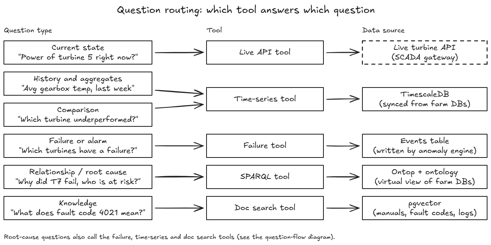
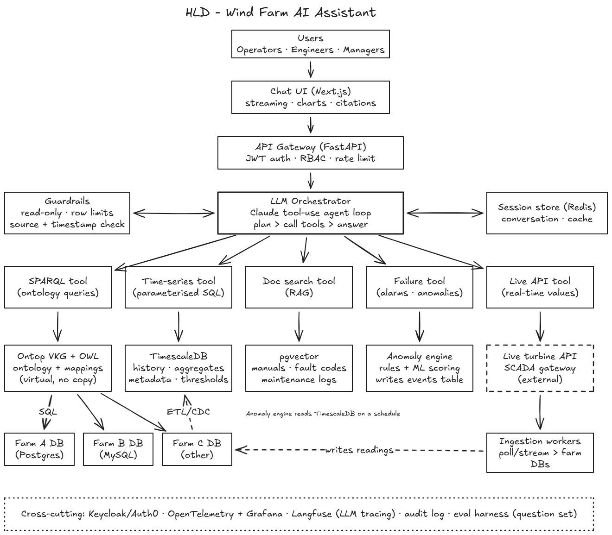
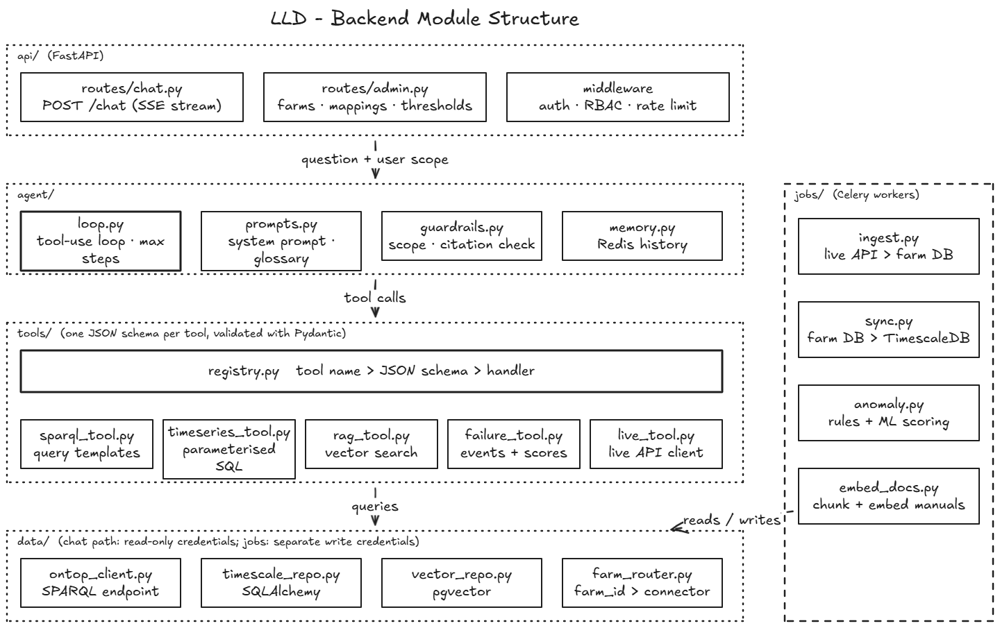
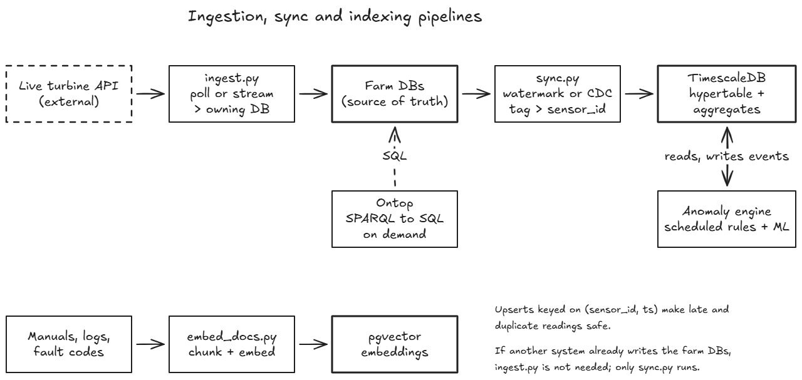

# Wind Farm AI Assistant: System Design (HLD + LLD)

A chatbot that lets users ask free-form questions about wind farms, turbines, sensors, live and historical data, and failures. The system covers multiple farms, each with its own database(s), plus a live data API.

**Status:** design proposal. Nothing here is built yet. Items marked **[verify]** are assumptions or recalled-from-memory details to check before committing.

Diagram sources (`.excalidraw`) and images (`.png`) are in [`diagrams/`](diagrams/).

---

## 1. Problem and requirements

**Inputs**
- Multiple farms; each farm has multiple turbines; each turbine has its own sensors.
- Each farm has its own database (types and schemas may differ).
- Live data arrives through an API and is stored in the farm databases.

**What users ask**

| Type | Example |
|---|---|
| Current state | "What is the power output of turbine 5 right now?" |
| History / aggregates | "Average gearbox temperature for Farm B last week" |
| Failure / alarm | "Which turbines have a failure?" |
| Relationship / root cause | "Why did turbine 7 fail, and which similar turbines are at risk?" |
| Knowledge | "What does fault code 4021 mean?" |
| Comparison | "Which turbine underperformed this month?" |



**Non-functional requirements**
- Every answer shows its data source and timestamp.
- Users only see farms they are allowed to see.
- The chat path has read-only access to operational data.
- Common questions answer quickly; responses stream.
- Heterogeneous farm databases work without blindly copying everything.

---

## 2. Key design decisions

| # | Decision | Rationale | Alternative |
|---|---|---|---|
| D1 | **OWL ontology + Ontop virtual knowledge graph** | One DB per farm with different schemas. Ontop maps each to one shared model and rewrites SPARQL to SQL, so no data is copied. | Neo4j (needs data loading, a second graph to maintain) |
| D2 | **TimescaleDB** for history and aggregates | SQL, continuous aggregates, retention, plain Postgres tooling | ClickHouse, InfluxDB |
| D3 | **Tool calling, not free-form query generation** | More reliable and secure: the model picks tools and arguments, code builds the queries | Free-form text-to-SQL / text-to-SPARQL |
| D4 | **The model never detects failures or does arithmetic** | Detection is a rules + ML pipeline; aggregation happens in the DB | Model reads raw rows |
| D5 | **pgvector** for manuals, fault codes, logs | Keeps vectors in Postgres, one fewer system | Qdrant |
| D6 | **Hybrid data access** | Virtual KG for structure, Timescale for time-series, live API for "now" | One store for everything |
| D7 | **No Neo4j for now** | Ontop + ontology cover the relationship questions | Add Neo4j if graph algorithms are needed |

Supporting research is thin: mostly preprints, vendor blogs, and prototypes, with little head-to-head testing on industrial time series. Reported findings: plain text-to-SQL struggles with time windows and downsampling; wind-turbine question answering over knowledge graphs exists as research prototypes (Chatterjee & Dethlefs, 2022); predefined semantic-layer metrics report higher accuracy than raw text-to-SQL (vendor-reported).

---

## 3. High-Level Design (HLD)



1. **Client:** chat UI (Next.js) with streaming, charts, and citations.
2. **Gateway:** FastAPI with JWT authentication, RBAC (user to allowed farms), and rate limiting.
3. **Orchestrator:** a Claude tool-use loop that plans, calls tools, and composes the answer. Works with **guardrails** (read-only, row limits, source and timestamp checks) and a **Redis session store**.
4. **Tools:** SPARQL (structure and relationships), time-series (parameterised SQL), doc search (RAG), failure (alarms and anomalies), live API (real-time values).
5. **Data layer:** Ontop with the OWL ontology and per-farm mappings, TimescaleDB, pgvector, the anomaly engine, and the farm databases as sources of truth.
6. **Ingestion:** workers write live API readings into farm databases; a sync job copies them into TimescaleDB.

Cross-cutting: Keycloak or Auth0, OpenTelemetry + Grafana, Langfuse for LLM tracing, an audit log, and an evaluation harness.

| Path | Source | Used for |
|---|---|---|
| Structure / relationships | Farm DBs via Ontop (virtual) | "What is part of what", "similar turbines" |
| Time-series | Farm DB, synced to TimescaleDB | Trends, aggregates, comparisons |
| Real-time | Live turbine API | "Right now" values |
| Knowledge | Documents in pgvector | Explanations, fault codes |
| Failures | Anomaly engine, events table | "Which turbine has a failure" |

---

## 4. Low-Level Design (LLD)

### 4.1 Question flow


For "Why did turbine 7 fail and who is at risk?":
1. The gateway authenticates the user and loads allowed farms.
2. The orchestrator calls the **failure tool** for the active event on T7.
3. The **SPARQL tool** finds turbines sharing the same gearbox model.
4. The **time-series tool** pulls the aggregated sensor trend for T7 and those turbines.
5. The **doc search tool** finds manual sections and past incidents.
6. Guardrails verify scope, citations, and timestamps; the answer streams back.

### 4.2 Backend modules



```
backend/
  api/        routes/chat.py, routes/admin.py, middleware
  agent/      loop.py, prompts.py, guardrails.py, memory.py
  tools/      registry.py, sparql_tool.py, timeseries_tool.py,
              rag_tool.py, failure_tool.py, live_tool.py
  data/       ontop_client.py, timescale_repo.py, vector_repo.py, farm_router.py
  jobs/       ingest.py, sync.py, anomaly.py, embed_docs.py
ontology/     wind.owl, mappings/<farm>.obda
eval/         questions.yaml, run_eval.py
```

### 4.3 Data model


- `sensor_concept` is the **standard name** layer: farm A `GBX_OIL_T` and farm B `gearbox_temp_1` both map to one concept (for example `gearbox_oil_temperature`) with unit, normal range, and alarm threshold.
- `reading` is a TimescaleDB **hypertable** on `ts`, with continuous aggregates (1 min, 10 min, 1 h) and a retention policy.
- `event` is written by the anomaly engine and by imported alarm codes; the failure tool reads it.
- `farm.db_conn_ref` is a **reference** to a secret in a vault, never a raw credential.

```sql
CREATE TABLE reading (
  ts        timestamptz NOT NULL,
  sensor_id uuid        NOT NULL REFERENCES sensor(sensor_id),
  value     double precision,
  quality   smallint
);
SELECT create_hypertable('reading', 'ts');
CREATE INDEX ON reading (sensor_id, ts DESC);
```

### 4.4 Ontology and virtual knowledge graph


- Reuse **SOSA/SSN** for sensors and observations. Consider **IEC 61400-25** and **RDS-PP/KKS** for component naming and **QUDT** for units **[verify scope and fit of each]**.
- Component subclasses (`Gearbox`, `Generator`, `PitchSystem`) let queries like "all gearboxes of model X" use the class hierarchy.
- Ontop supports relational databases. A farm using a non-relational time-series store needs a relational view or a sync into Timescale **[verify per farm]**.
- Ontop handles **structure and relationships**. Raw time-series reads go through the time-series tool, not SPARQL.

Mapping per farm (sketch; **[verify exact syntax against the Ontop version used]**):
```
[PrefixDeclaration]
:      http://example.org/wind#
sosa:  http://www.w3.org/ns/sosa/

[MappingDeclaration] @collection [[
mappingId  farmA-turbine
target     :turbine/{turbine_id} a :Turbine ; :hasCode {code} ; :partOfFarm :farm/{farm_id} .
source     SELECT turbine_id, code, farm_id FROM turbines
]]
```

### 4.5 Tool contracts

Each tool has a JSON schema; arguments are validated with Pydantic before any query runs. The model never submits raw SQL or SPARQL.

| Tool | Arguments | Returns |
|---|---|---|
| `get_latest_reading` | `turbine_id`, `concept` | value, unit, timestamp, source |
| `get_timeseries` | `turbine_ids[]`, `concept`, `start`, `end`, `agg`, `stat` | aggregated series (capped), thresholds |
| `list_failures` | `farm_id?`, `severity?`, `since?`, `active_only` | events with turbine, component, type, times |
| `find_similar_turbines` | `turbine_id`, `by` (model, component, part) | turbine list via a SPARQL template |
| `get_turbine_structure` | `turbine_id` | components and sensors |
| `compare_turbines` | `turbine_ids[]`, `concept`, `period` | per-turbine statistic and ranking |
| `search_docs` | `query`, `turbine_model?` | chunks with document id and page |
| `get_live_value` | `turbine_id`, `concept` | live value, timestamp |

```json
{
  "name": "get_timeseries",
  "description": "Aggregated sensor values for one or more turbines over a time range.",
  "input_schema": {
    "type": "object",
    "properties": {
      "turbine_ids": {"type": "array", "items": {"type": "string"}, "maxItems": 20},
      "concept": {"type": "string", "description": "Standard sensor concept, e.g. gearbox_oil_temperature"},
      "start": {"type": "string", "format": "date-time"},
      "end": {"type": "string", "format": "date-time"},
      "agg": {"type": "string", "enum": ["1m", "10m", "1h", "1d"]},
      "stat": {"type": "string", "enum": ["avg", "min", "max"]}
    },
    "required": ["turbine_ids", "concept", "start", "end", "agg"]
  }
}
```

SPARQL runs through **predefined templates** with bound parameters (for example `similar_turbines`, `components_of`, `sensors_of`). A guarded free-form SPARQL tool (read-only, timeout, result cap) is optional and should be enabled only if templates prove insufficient.

### 4.6 Agent loop
```python
def answer(question, user):
    scope = rbac.allowed_farms(user)
    messages = memory.load(user) + [question]
    for step in range(MAX_STEPS):              # e.g. 8
        resp = claude.messages.create(model=MODEL, system=SYSTEM_PROMPT,
                                      tools=registry.schemas(), messages=messages)
        if resp.stop_reason != "tool_use":
            return guardrails.check(resp, sources, scope)   # citations, timestamps, scope
        for call in resp.tool_uses:
            guardrails.validate_call(call, scope)           # args + farm access
            result = registry.run(call, scope)              # read-only, capped
            sources.add(result.source)
            messages.append(tool_result(call, result))
    return "Could not complete within step limit."
```
Use a stronger model for the main loop and a cheaper one for routing if useful. Confirm current model IDs and pricing at build time **[verify]**.

### 4.7 Failure / anomaly detection
- **Rules:** threshold breaches from `sensor_concept` limits; imported alarm codes.
- **Statistical / ML:** a normal-behaviour model per turbine type (predict expected value from related sensors, flag large residuals) or isolation-forest style scoring. Choose after looking at real data.
- Runs on a schedule, writes to `event` with a score, contributing sensors, and time window.
- The model reads these events; it does not decide whether a failure occurred.

### 4.8 Ingestion and sync



1. `ingest.py` polls or subscribes to the live API and writes into the owning farm DB (respecting that farm's schema).
2. `sync.py` copies new readings from farm DBs into TimescaleDB (watermark or CDC), mapping source tags to `sensor_id`.
3. Late or duplicate data is handled with idempotent upserts keyed on `(sensor_id, ts)`.
4. If another system already writes the farm DBs, `ingest.py` is not needed. Confirm who owns writes to each farm DB.
5. `embed_docs.py` chunks and embeds manuals, fault codes, and maintenance logs into pgvector.

### 4.9 Security and access control
- JWT from the identity provider; RBAC maps users to farms (`user_farm_access`).
- Every tool call is scoped to the user's farms **server-side**. The model cannot widen scope by prompt.
- Chat path uses **read-only DB credentials**; jobs use separate write credentials.
- Query timeouts, row caps, and per-user rate limits.
- Treat document text and tool output as **untrusted input** to the model (prompt-injection risk from ingested documents).
- Audit log: user, question, tools called, arguments, sources.

---

## 5. Technology stack

| Area | Choice |
|---|---|
| API | FastAPI, Pydantic, SSE/WebSocket |
| LLM | Claude with tool use (Anthropic SDK) |
| Semantic layer | OWL ontology, Ontop (virtual KG), SPARQL; Protégé for editing |
| Time-series + metadata | PostgreSQL + TimescaleDB |
| Vector search | pgvector |
| Cache / sessions | Redis |
| Jobs | Celery (or Arq) + Redis |
| ML | scikit-learn, PyOD, pandas/Polars |
| Frontend | Next.js, Recharts or Plotly |
| Auth | Keycloak or Auth0 |
| Observability | OpenTelemetry, Grafana, Langfuse |

---

## 6. Alternatives and when to revisit
- **Add Neo4j** if you need graph algorithms or fast multi-hop traversal over a materialised graph.
- **Move to ClickHouse** if read volume outgrows TimescaleDB.
- **Federated query engine (Trino)** if many farms use many different DB types and syncing everything is undesirable.
- **Free-form SPARQL/SQL tool** only if templates cover too little.
